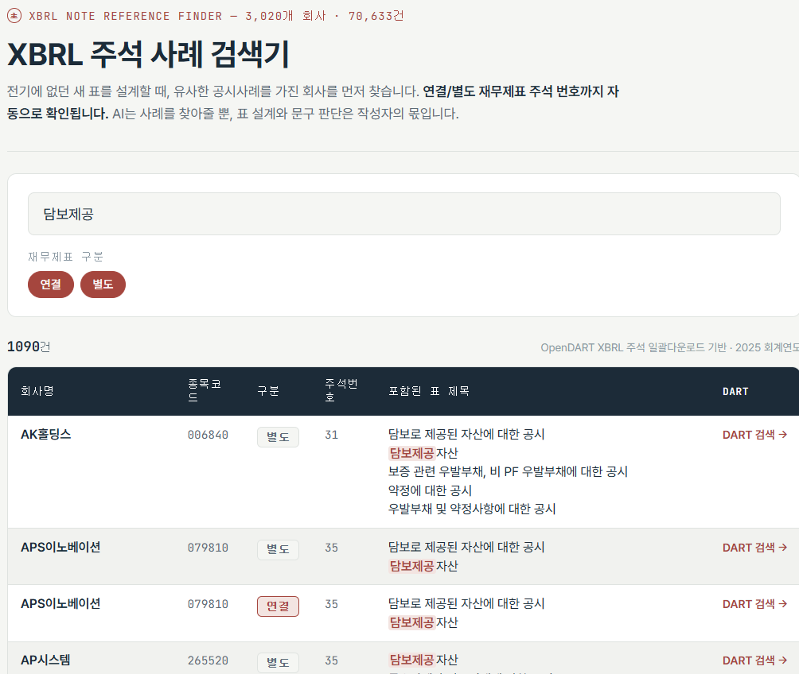
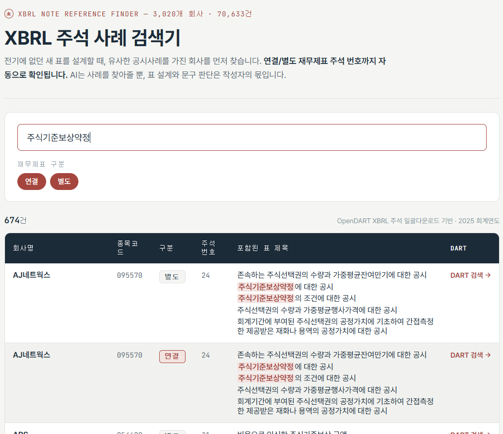
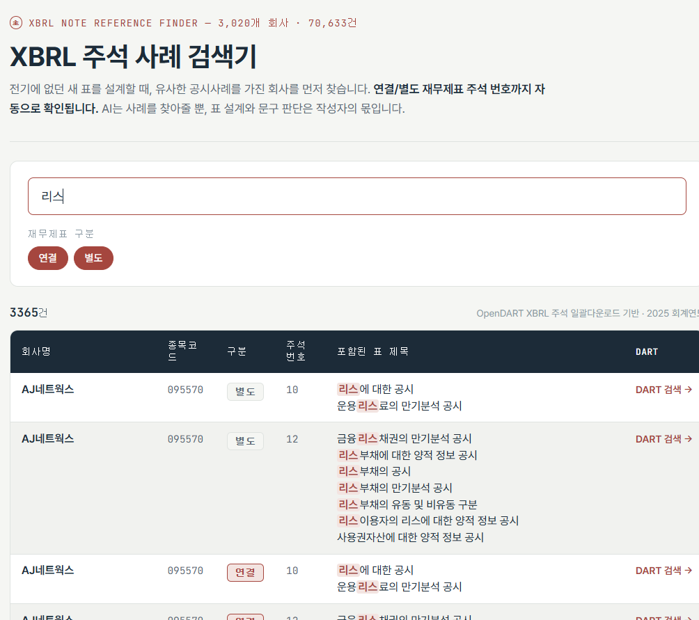

# XBRL 주석 사례 검색기 (XBRL Note Finder)

> 전기 공시에 없던 새로운 주석·표를 설계할 때, 유사한 공시사례를 가진 회사를 빠르게 찾기 위한 도구입니다.

🔗 **실행 링크**: https://ks94kim1-beep.github.io/xbrl-note-finder/

---

## 1. 업무 배경 (Pain Point)

삼일회계법인 XBRL 공시팀에서 근무하며, 전기 공시에 없던 새로운 주석이나 표를 설계할 때 여러 기업의 유사 공시사례를 참고해야 하는 경우가 많았습니다. 이때 회사별로 공시 파일을 하나씩 열어 원하는 표현이 포함된 주석을 찾아야 했고, 검색어 표현이 조금만 달라도 관련 사례를 놓치기 쉬웠습니다.

이 반복 작업을 개선하기 위해, OpenDART가 제공하는 XBRL 주석 일괄다운로드 데이터를 활용해 키워드 하나로 전체 상장사의 주석 사례를 검색할 수 있는 도구를 직접 만들었습니다.

## 2. 실행 화면

**검색 예시 1 — "담보제공" (1,090건)**

**검색 예시 2 — "주식기준보상약정" (674건)**

**검색 예시 3 — "리스" (3,365건)**

검색 결과에는 회사명·종목코드·연결/별도 구분·주석번호·포함된 표 제목이 함께 표시되며, 각 결과의 **DART 검색 →** 버튼을 누르면 해당 회사의 DART 원문 화면으로 바로 연결되어 원문을 직접 대조·검증할 수 있습니다.

## 3. 사용 방법 (3단계)

1. 검색창에 찾고자 하는 주석 표현(예: "리스", "담보제공", "주식기준보상약정")을 입력합니다.
2. 필요하면 연결/별도 재무제표 구분을 선택해 결과를 좁힙니다.
3. 결과 목록에서 회사를 확인하고, DART 검색 버튼으로 원문 공시를 열어 실제 표 구조와 문구를 대조합니다.

## 4. 데이터

- **출처**: OpenDART XBRL 주석 일괄다운로드 (2025 회계연도)
- **규모**: 3,020개 기업, 70,633건의 주석 레코드
- **처리 과정**: sub.tsv, lab.tsv, role.tsv, pre.tsv 등 OpenDART 원천 TSV 파일을 PowerShell로 1차 필터링 후 병합
- **연결/별도 판별**: role.tsv의 ROLE_ID 규칙을 직접 분석해 발견 — 끝자리 0은 연결, 5는 별도 재무제표를 의미
- **원문 연계**: 검색 결과의 연도를 벗어난 이력(5년/10년 단위 비교)이 필요한 경우, DART 원문 링크를 통해 확인 가능하도록 설계했습니다. 다만 이 다년도 조회 기능 자체는 DART 사이트가 제공하는 기능이며, 본 도구는 2025 회계연도 데이터를 기반으로 검색 결과를 제공합니다.

## 5. AS-IS / TO-BE

| 구분 | AS-IS (기존 방식) | TO-BE (검색기 도입 후) |
|---|---|---|
| 사례 검색 | 여러 공시 파일을 개별적으로 열어 검색 | 3,020개 기업 데이터를 통합해 한 번에 검색 |
| 검색 방식 | 정확한 표현을 직접 예상해 검색 | 키워드 일치 결과를 표 제목·연결/별도 기준으로 한눈에 비교 |
| 결과 정리 | 검색 결과를 수작업으로 취합 | 회사명·종목코드·주석번호·표 제목이 자동 정리되어 표시 |
| 원문 검증 | 원본 공시를 다시 찾아 대조 | 결과에서 DART 원문으로 바로 연결해 대조 |

## 6. 검증 방법

이 도구는 검색 결과를 그대로 제공하는 데 그치지 않고, **결과의 신뢰도를 검증할 수 있는 구조**로 설계했습니다.

- 검색 결과 건수가 실제 OpenDART 원천 데이터의 레코드 수와 일치하는지 원본 TSV와 대조해 확인했습니다.
- 화면 상단에 "AI는 사례를 찾아줄 뿐, 표 설계와 문구 판단은 작성자의 몫입니다"라는 문구를 명시해, 검색 결과가 최종 판단을 대신하지 않는다는 점을 이용자에게 안내합니다.
- 모든 검색 결과에 DART 원문 링크를 제공해, 이용자가 도구의 결과를 맹신하지 않고 직접 원문을 대조할 수 있도록 했습니다.

## 7. 기대 효과

여러 파일을 개별적으로 열어 검색하던 방식에서, 키워드 한 번으로 전체 상장사 주석 사례를 조회하는 방식으로 전환해 사례 조사에 걸리는 시간과 검색 누락 가능성을 줄이는 것을 목표로 합니다.

## 8. 한계와 향후 개선 방향

- 현재는 정확한 키워드 일치 검색만 지원합니다. 향후 "주식기준보상", "스톡옵션"처럼 관련 표현을 함께 검색하는 기능을 추가할 계획입니다.
- 생성형 AI를 활용한 주석 요약 기능도 검토 중이나, 요약이 원문의 의미를 왜곡하지 않는지 검증하는 절차를 함께 마련한 뒤 신중하게 도입할 예정입니다.
- 검색 대상 연도를 2025 회계연도 외로 확장하는 것도 향후 과제입니다.

## 9. 개발 과정

- 필요한 기능과 데이터 처리 방식을 직접 정의하고, 생성형 AI 도구를 활용해 구현했습니다.
- 완성된 결과는 원천 데이터와 대조하며 검토했고, 연결/별도 판별 규칙(role.tsv ROLE_ID)은 실제 사례(한독의 "유형자산 담보제공내역" 주석 13)로 검증했습니다.
- 선배가 만든 MyDART Viewer를 참고해 벤치마크 방향을 잡았습니다.

---

**제작**: 김경식 (한국외국어대학교 경영학과, 공인회계사) · **기술**: Python, pandas, OpenDART Open API, GitHub Pages
